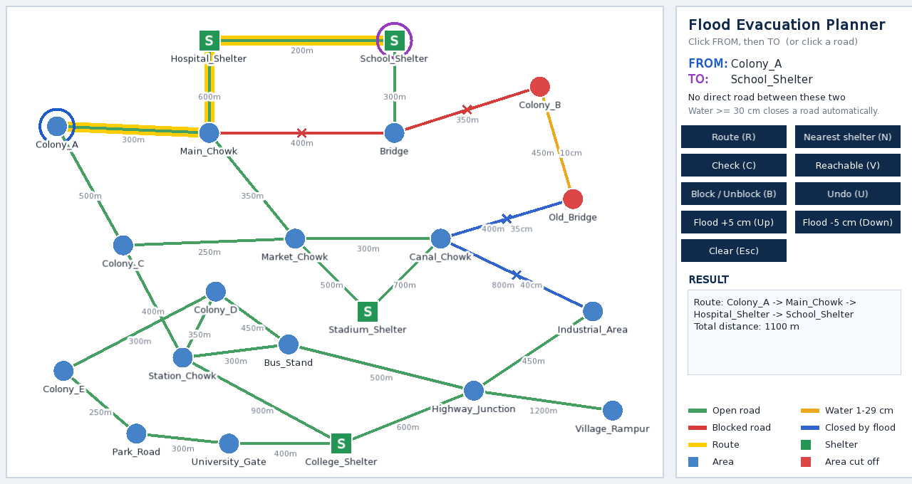

# Flood Evacuation Planner

CS-201L Data Structures Lab project (C++17) with a console version and an SFML GUI.

During a flood, roads close and the safe route changes. This program finds the **nearest safe
shelter and the shortest open route**. A road can be blocked by the user, or it closes
automatically when the water level reaches 30 cm. Routes are recalculated after every change,
and the program warns when an area is completely cut off from all shelters.

**Research gap:** normal navigation apps assume a static road network. In a flood the network
changes hour by hour, so routing has to be dynamic and disaster-aware.



## Contents

1. [Installation guide (Windows)](#installation-guide-windows)
2. [Build and run](#build-and-run)
3. [How to use](#how-to-use)
4. [Data structures](#data-structures)
5. [Map file format](#map-file-format)
6. [Project structure](#project-structure)
7. [Working with Git](#working-with-git)
8. [Troubleshooting](#troubleshooting)

---

## Installation guide (Windows)

You need a C++ compiler (g++) and VS Code. SFML is only needed for the GUI version.

### Step 1: Install VS Code

Download from https://code.visualstudio.com and install. Then open VS Code, press `Ctrl+Shift+X`,
search for **C/C++** (publisher: Microsoft) and click Install.

### Step 2: Install MSYS2 (gives you g++)

1. Download the installer from https://www.msys2.org and install it with the default options.
2. Open **MSYS2 UCRT64** from the Start menu (the terminal with the purple/blue prompt).
3. Paste this and press Enter. When asked `Enter a selection (default=all)` press Enter, then type `Y`:

```
pacman -S --needed --disable-download-timeout base-devel mingw-w64-ucrt-x86_64-toolchain
```

In this terminal paste with right-click or `Shift+Insert` (`Ctrl+V` may not work).

### Step 3: Add g++ to PATH

1. In the MSYS2 UCRT64 terminal run `cygpath -w /ucrt64/bin` and note the path it prints
   (usually `C:\msys64\ucrt64\bin`, but it can be a different folder).
2. Open PowerShell (normal, not admin) and run, replacing the path in the quotes with yours:

```
[Environment]::SetEnvironmentVariable("Path", [Environment]::GetEnvironmentVariable("Path","User") + ";C:\msys64\ucrt64\bin", "User")
```

3. Close every PowerShell / Command Prompt / VS Code window, then open a **new** one and check:

```
g++ --version
gdb --version
```

Both should print a version. If they say "not recognized", the PATH step did not work (see Troubleshooting).

### Step 4: Install SFML (GUI version only)

In the MSYS2 UCRT64 terminal:

```
pacman -S --needed --disable-download-timeout mingw-w64-ucrt-x86_64-sfml
```

This installs SFML 3. The console version works without it.

### Step 5: Get the project

Either download the zip from GitHub and extract it, or clone it:

```
git clone https://github.com/Durr-e-Insharah/flood-evacuation-planner.git
```

Put the folder somewhere **outside OneDrive** (for example `C:\Projects`), then in VS Code use
**File > Open Folder** and open it. Open a terminal with `` Ctrl+` ``: it starts inside the project folder.

---

## Build and run

Run these in the VS Code terminal (PowerShell). In PowerShell, programs in the current folder need `.\` in front.

### Console version (no SFML needed)

```
g++ -std=c++17 -Wall -Wextra -O2 src/*.cpp -o planner.exe
.\planner.exe data/map.txt
```

or just `.\build.bat`.

### GUI version (needs SFML, Step 4)

```
g++ -std=c++17 -O2 gui/gui_main.cpp src/graph.cpp src/planner.cpp -o planner_gui.exe -lsfml-graphics -lsfml-window -lsfml-system
.\planner_gui.exe data/map.txt
```

or just `.\build_gui.bat`. After the first build you only need `.\planner_gui.exe data/map.txt`.
You only need to compile again when the `.cpp` / `.h` files change; editing `data/map.txt` needs no rebuild.

### With CMake (optional)

```
cmake -S . -B build
cmake --build build
```

`planner_gui` is built only if SFML 3 is found.

---

## How to use

### Console commands

After starting `planner.exe` you get a `>` prompt. Type a command and press Enter.

| Command | What it does |
|---|---|
| `SHOW` | List all locations and roads with status |
| `ROUTE a b` | Shortest open route from a to b |
| `NEAREST a` | Nearest reachable shelter from a, with route |
| `CHECK a` | Is a still connected to any shelter? |
| `REACHABLE a` | Every location a can still reach |
| `BLOCK a b` | Close the road between a and b |
| `UNBLOCK a b` | Reopen a manually blocked road |
| `FLOOD a b cm` | Set water level; 30 cm or more closes the road |
| `UNDO` | Undo the last BLOCK / UNBLOCK / FLOOD |
| `LOAD file` | Load another map file |
| `HELP`, `EXIT` | Help, quit |

Names are not case sensitive. Example session:

```
> ROUTE Colony_A School_Shelter
Route: Colony_A -> Main_Chowk -> Bridge -> School_Shelter
Total distance: 1000 m

> BLOCK Bridge Main_Chowk
Road Bridge <-> Main_Chowk closed.

> ROUTE Colony_A School_Shelter
Route: Colony_A -> Main_Chowk -> Hospital_Shelter -> School_Shelter
Total distance: 1100 m

> FLOOD Colony_B Old_Bridge 35
Water level on Colony_B <-> Old_Bridge set to 35 cm. Road AUTO-CLOSED (limit 30 cm).
```

A ready-made script: `Get-Content data/demo_commands.txt | .\planner.exe data/map.txt`

### GUI

Click a location (FROM), then another (TO), or click a road to pick both ends. Then use the buttons or keys:

| Key | Action |
|---|---|
| `R` | Route from FROM to TO (drawn in gold) |
| `N` | Nearest shelter from FROM |
| `C` | Check if FROM is cut off |
| `V` | List everything FROM can still reach |
| `B` | Block / unblock the selected road |
| `Up` / `Down` | Water level +5 / -5 cm on the selected road |
| `U` | Undo |
| `Esc` | Clear selection |
| `P` | Save `screenshot.png` |

Colours: green = open road, amber = water 1-29 cm, red = blocked, blue = closed by flood,
gold = route, green square = shelter, blue circle = area, red circle = area cut off from every shelter.
All roads start open except one (Canal_Chowk - Industrial_Area, 40 cm of water), so red roads
appear only after you block something.

---

## Data structures

| Data structure | Where (C++) | Used for |
|---|---|---|
| Graph, Adjacency List | `Graph` in `graph.h` (`vector<vector<Edge>>`) | Map: locations = nodes, roads = edges (distance, flood level, blocked) |
| Hash Table | `unordered_map<string,int>` in `Graph` | Location name -> node id, O(1) average |
| Min-Heap (Priority Queue) | `priority_queue` in `Planner::shortestPath` | Dijkstra: pick the closest unvisited node, O(log V) |
| Union-Find (DSU) | `union_find.h` (path halving + union by rank) | `CHECK`, `NEAREST`, `ROUTE`: instant "is it still connected?" |
| Queue | `queue<int>` in `Planner::reachable` | BFS for `REACHABLE` |
| Stack | `stack<Action>` and `stack<int>` in `planner.cpp` | `UNDO` history; reversing the path found by Dijkstra |

Union-Find cannot split sets, so after every BLOCK / UNBLOCK / FLOOD / UNDO it is rebuilt from the open roads (O(E)).

| Operation | Complexity |
|---|---|
| Dijkstra (`ROUTE`, `NEAREST`) | O((V + E) log V) |
| BFS (`REACHABLE`) | O(V + E) |
| Union-Find find / union | O(alpha(V)), almost O(1) |
| Rebuild Union-Find | O(E * alpha(V)) |
| Name lookup | O(1) average |
| Memory | O(V + E) |

---

## Map file format

`data/map.txt` is plain text:

```
NODE <name> <AREA|SHELTER> [x y]             # x y = position on the GUI map (optional)
EDGE <from> <to> <distance_m> <flood_cm>     # roads are two-way
```

Lines starting with `#` are comments. Use underscores instead of spaces in names. If `x y` is missing
for any location, the GUI places all locations on a circle. The sample map has 21 locations,
4 shelters and 28 roads.

---

## Project structure

```
src/
  main.cpp        console command loop
  planner.h/.cpp  commands, Dijkstra, BFS, undo
  graph.h/.cpp    adjacency list + hash table
  union_find.h    disjoint set union
gui/
  gui_main.cpp    SFML 3 window (draws the map, buttons, clicks)
data/
  map.txt                sample map
  demo_commands.txt      demo script for the console version
docs/
  gui_screenshot.png
  Flood_Evacuation_Planner_Summary.docx
CMakeLists.txt, build.bat, build_gui.bat, .gitignore, README.md
```

---

## Working with Git

First push (create an empty repository on github.com first, without a README):

```
git init
git add .
git commit -m "Initial commit: Flood Evacuation Planner"
git branch -M main
git remote add origin https://github.com/Durr-e-Insharah/flood-evacuation-planner.git
git push -u origin main
```

Teammates: add them under **Settings > Collaborators**, then each one runs:

```
git clone https://github.com/Durr-e-Insharah/flood-evacuation-planner.git
git checkout -b my-feature
git add .
git commit -m "Describe what you changed"
git push -u origin my-feature
```

Run `git pull` on `main` before starting work, and merge branches through Pull Requests.
`.gitignore` already excludes `.exe` files and build folders.

---

## Troubleshooting

| Problem | Fix |
|---|---|
| `g++` / `gdb` is not recognized | PATH step missing or terminal not restarted. Redo Step 3 and open a **new** terminal. |
| `planner.exe is not recognized` | In PowerShell type `.\planner.exe` (with `.\`). |
| `No such file or directory` for `src/...` or `gui/...` | The terminal is in the wrong folder. Open the project folder in VS Code, or `cd` into it, and run `dir` to check you see `src`, `gui`, `data`. |
| `SFML/Graphics.hpp: No such file` | SFML is not installed. Do Step 4. |
| GUI window does not start / missing DLL | Make sure the MSYS2 `ucrt64\bin` folder is on PATH (Step 3), then open a new terminal. |
| `Could not find a font` | Put any `.ttf` font file at `assets/font.ttf`. Windows normally has Segoe UI / Arial already. |
| `pacman` download times out | Add `--disable-download-timeout`, retry, or use a better connection or mobile hotspot. |
| Keys do nothing in the GUI | Click on the GUI window first so it has focus. |